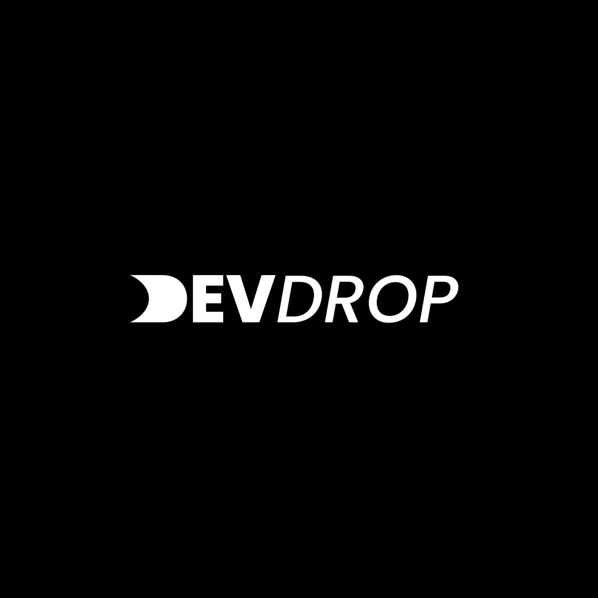
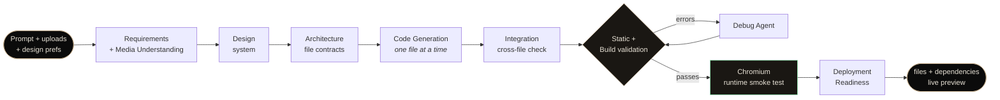
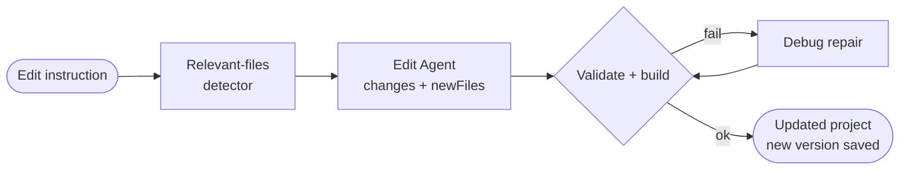
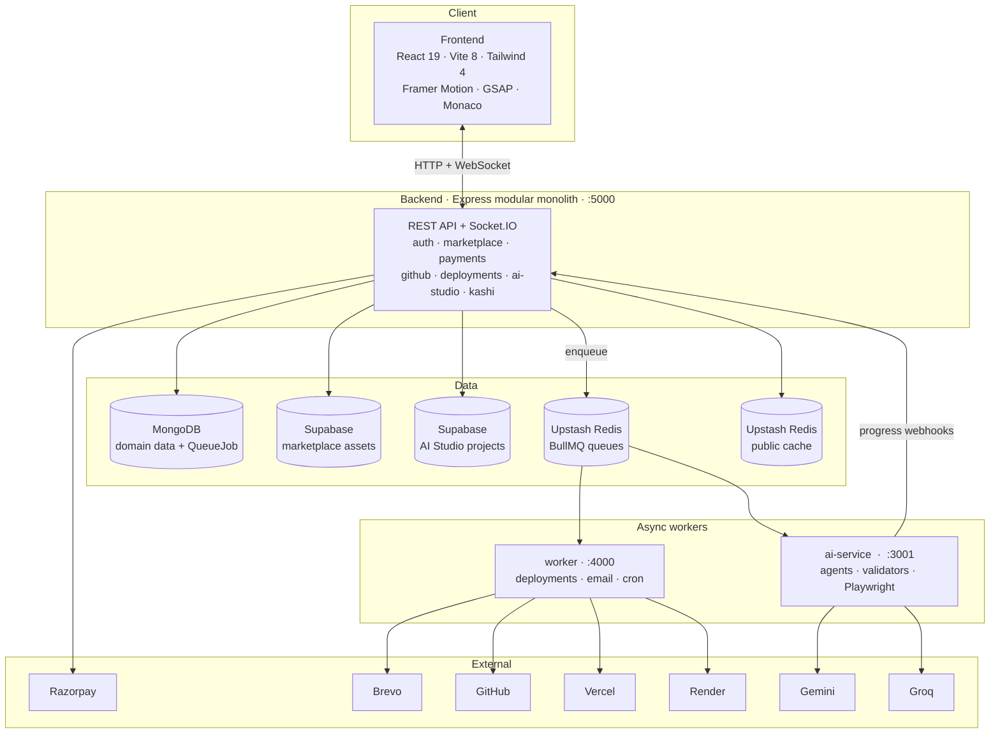
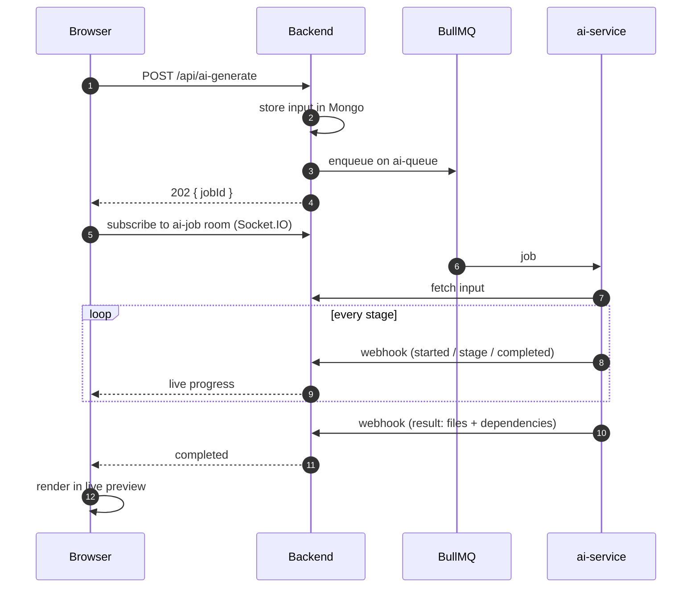
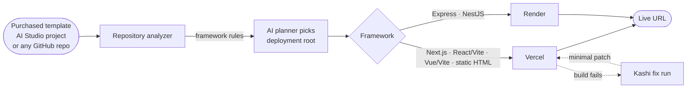

<div align="center">




### The website marketplace that also builds and ships your site.

A full-stack platform where developers **sell** production-ready websites, buyers **own and deploy** them in a few clicks, and anyone can **generate a brand-new site with a multi-agent AI pipeline**, then push it live to Vercel or Render.

<br/>


<br/>

[**Features**](#-features) &nbsp;·&nbsp; [**AI Studio**](#-ai-studio--the-multi-agent-pipeline) &nbsp;·&nbsp; [**Architecture**](#-system-architecture) &nbsp;·&nbsp; [**Quick Start**](#-quick-start) &nbsp;·&nbsp; [**API Map**](#-api-map) &nbsp;·&nbsp; [**Team**](#-team)

</div>

<br/>

---

## ✦ What is DevDrop?

DevDrop is three products in one codebase, sharing one account, one wallet of trust, and one deployment engine:

<table>
<tr>
<td width="33%" valign="top">

### 🛒 Marketplace
Sellers list full website projects (free, paid, or exclusive). Buyers purchase through Razorpay, get signed-URL access to source, and can bid in **auctions** for exclusive listings. Sellers get payouts, admins get a review queue.

</td>
<td width="33%" valign="top">

### 🪄 AI Studio
Describe a site, pick a style, and a **7-agent pipeline** designs, architects, codes, builds, browser-tests, and repairs a real React + Vite project, live in your browser. Edit it in plain English afterwards.

</td>
<td width="33%" valign="top">

### 🚀 Deploy
Point at a purchased template, an AI Studio project, or **any GitHub repo**. DevDrop analyzes the framework, picks the right host, and ships to **Vercel** or **Render**. If the build fails, **Kashi** reads the logs and fixes it.

</td>
</tr>
</table>

---

## ✦ Features

<details open>
<summary><b>🛒 Marketplace &amp; commerce</b></summary>

<br/>

- **Three listing tiers:** `free`, `paid`, `exclusive`, with price validation enforced at the schema level
- **Razorpay payments** with raw-body **webhook signature verification**
- **Auctions** with bid-wait and payment-window timers; ended auctions are processed by a scheduler every minute
- **Coupons**, platform fee, and tax configuration
- **Seller payouts** with an admin pending/process/fail workflow and bank-details setup
- **Wishlists**, reviews, contact/support inbox
- **Signed-URL asset delivery** (Supabase Storage) with download logging and rate limits
- **Export to GitHub:** buyers connect GitHub and push a purchased project into their own repo

</details>

<details open>
<summary><b>🪄 AI Studio</b></summary>

<br/>

- **10 website types:** Portfolio, E-commerce, Blog / Magazine, Landing Page, Cafe / Restaurant, Hotel / Stay, Freelancing Studio, Event / Conference, Education / Course, Custom
- **Design controls:** 18 visual styles · 6 text themes · 12 colour palettes · 9 typography systems · 7 animation levels
- **Multimodal:** upload images, videos, PDFs and resumes; the Requirements agent actually *looks* at them and plans where each belongs
- **Style-reference capture:** pick a preview and its full-page screenshot becomes a visual reference for the generator
- **Live preview** in a sandboxed WebContainer runtime with desktop / mobile device frames
- **Edit with AI** (incremental, file-targeted) and **version history**
- **Fix with AI / Debug-only retry** when a build breaks
- **Download as ZIP**, push to GitHub, or **ship straight to Vercel / Render**

</details>

<details open>
<summary><b>🧠 Reliability engineering behind the AI</b></summary>

<br/>

- **Gemini API-key pool** with priority, LRU selection, cooldowns, health tracking, and automatic failover on 429 / 503 / timeouts
- **Groq key pool** for the fast models that power Kashi and the deployment planner
- **Real browser smoke test** (Playwright + Chromium) on every generated build, so "it compiled" isn't mistaken for "it works"
- **Deployment-readiness agent** scans for `process.env` leaks, `localhost` URLs and missing assets *before* you deploy
- **Quota-aware jobs:** exhausted quota *delays* a job instead of burning retries; the worker slot is released while waiting
- Keys are **AES-encrypted at rest** and never appear in error messages

</details>

<details open>
<summary><b>🤖 Kashi, the in-app assistant</b></summary>

<br/>

- Answers questions about DevDrop and **navigates you** to the right page, validated against a route map so it can never send you somewhere that doesn't exist
- **Fixes failed deployments:** reads the build log, asks for only the files it needs, and applies **exact find/replace edits** with hard caps (max edits, max changed lines). Lockfiles and `.env` files are untouchable. Edits are enforced in code, not just in the prompt.

</details>

<details>
<summary><b>🛡️ Admin &amp; operations</b></summary>

<br/>

- Admin panel: dashboard, websites, **review queue**, coupons, payouts, **Gemini pool**, **Groq pool**, backups
- **Live pool status over Socket.IO**
- Scheduled **MongoDB + Supabase backups** to independent destinations
- **Sentry** (backend + frontend) and **PostHog** analytics

</details>

---

## ✦ Website types

AI Studio ships with artwork-driven type selection. Each card below is a starting point the pipeline specialises (sections, copy structure, media plan) for that kind of site.

<table>
<tr>
<td align="center" width="25%"><br/><b>Portfolio</b></td>
<td align="center" width="25%"><br/><b>E-commerce</b></td>
<td align="center" width="25%"><br/><b>Blog / Magazine</b></td>
<td align="center" width="25%"><br/><b>Landing Page</b></td>
</tr>
<tr>
<td align="center"><br/><b>Cafe / Restaurant</b></td>
<td align="center"><br/><b>Hotel / Stay</b></td>
<td align="center"><br/><b>Freelancing Studio</b></td>
<td align="center"><br/><b>Event / Conference</b></td>
</tr>
<tr>
<td align="center"><br/><b>Education / Course</b></td>
<td align="center"><br/><b>Custom</b></td>
<td colspan="2" align="center"><i>…plus 18 design styles from <b>Minimal</b> to <b>Glassmorphism</b>, <b>Claymorphism</b>, <b>Neo-Brutalist</b>, <b>Cyberpunk</b>, <b>Bento Grid</b>, <b>Luxury</b>, <b>Retrofuturism</b> and <b>Maximalist Collage</b>.</i></td>
</tr>
</table>

---

## ✦ AI Studio — the multi-agent pipeline

A generation request is **not** one giant prompt. It is a staged pipeline where every agent has one job, a strict JSON contract, and a validator between it and the next stage.



| # | Stage | What it does |
|---|---|---|
| 1 | **Requirements + Media** | Normalises the brief, preserves the chosen `websiteType`, inspects every uploaded image/video, and emits a per-asset `mediaPlan` (role, placement, crop, focal point). Documents like resumes are mined as *content*, not treated as media. |
| 2 | **Design** | Turns requirements + media plan + style preferences into one coherent design system. A style-reference screenshot can steer it. |
| 3 | **Architecture** | Produces the file-level contract for a minimal React + Vite project: paths, imports, responsibilities. No code yet. |
| 4 | **Code Generation** | Writes **exactly one file per call**, in dependency order (`package.json` → `index.html` → entry → data → components). The architecture owns the path; the model only controls the source. |
| 5 | **Integration** | Verifies the whole project against requirements/design/architecture and repairs only implicated files. |
| 6 | **Validation loop** | Static validators → real `build` → on failure the **Debug Agent** patches and the loop retries (`MAX_BUILD_FIX_RETRIES`). |
| 7 | **Runtime smoke test** | Loads the built `dist/` in headless Chromium and fails on uncaught exceptions, console errors, missing local JS/CSS, or an empty app root. |
| 8 | **Deployment readiness** | A deterministic scanner finds env-var reads, `localhost` URLs and missing assets; a focused agent applies the smallest possible fix. |

### Editing without regenerating



The edit orchestrator sees the full file **tree** but only the source of the few files most likely to matter (`EDIT_MAX_RELEVANT_FILES`, default 6). It is told never to regenerate from scratch and never to touch an uploaded asset reference.

### Gemini failover, in one table

| Failure | Handling |
|---|---|
| `429` per-minute quota | Cool that project + model, **switch key immediately** |
| `429` daily quota | Unavailable until the reported reset, never a short retry |
| `503` / overloaded | Model avoided pool-wide, next model tried |
| `401` / `403` / invalid key | Key marked `invalid`, never rotated back |
| `500` / `502` / timeout | Bounded backoff with jitter, another key first |
| `400` / unsupported model | Surfaced immediately, not rotated |
| Unparseable JSON on `200` | Retried on a few other keys, no cooldown |

If **no** key is eligible the job reports `waiting_for_capacity`, releases its worker slot, and resumes the same stage later.

---

## ✦ System architecture



### Four processes, one job each

| Service | Port | Responsibility |
|---|---|---|
| **`frontend/`** | `5173` | React SPA: marketplace, AI Studio, workspace, admin panel, Kashi widget |
| **`backend/`** | `5000` | HTTP + Socket.IO. Auth, marketplace, payments, producers for every queue. Never blocks on slow work. |
| **`worker/`** | `4000` | Consumes `deployment-queue` and `events-queue`: deployments, GitHub exports, Kashi fix runs, transactional email, scheduled jobs |
| **`ai-service/`** | `3001` | Consumes `ai-queue`: runs the whole agent pipeline, reports progress back by signed webhook |

### Queues (BullMQ on Upstash)

| Queue | Producer | Consumer | Work |
|---|---|---|---|
| `ai-queue` | backend | `ai-service` | AI Studio generate / edit / debug |
| `deployment-queue` | backend | `worker` | Deployments, GitHub exports, Kashi fix runs |
| `events-queue` | backend | `worker` | Email, outbox republisher, auctions, cleanups, backups |

> Two **separate** Redis databases, and neither ever falls back to the other: `QUEUE_REDIS_URL` (BullMQ only) and `CACHE_REDIS_URL` (disposable listing cache, optional). MongoDB holds the durable job record; Redis holds only queue state.

### Scheduled jobs

| Schedule | Default | Purpose |
|---|---|---|
| Ended auctions | every 60 s | Close auctions, notify winners |
| AI Studio cleanup | `*/5 * * * *` | Delete abandoned projects (no heartbeat for 20 min) |
| Supabase cleanup | `0 3 * * 0` | Purge stale template assets |
| Backup | every 24 h | MongoDB + Supabase to independent targets |
| Outbox sweep | every 60 s | Republish business-event emails that never reached Redis |

### Request flow for an AI generation



If the tab refreshes, `GET /api/ai-generate/jobs/:id` recovers the status. Results are kept in Mongo for ~30 minutes.

---

## ✦ Deployment engine



- **Data-driven framework rules** (`analyzer/frameworkRules.js`): add a framework by adding a rule, not rewriting the orchestrator
- **AI planner** chooses among *candidate roots only*, so it can never invent a path. Monorepos pick the real app, not a shared UI package.
- **Vercel** via OAuth integration · **Render** via the buyer's own API key
- Environment variables are scanned and synced; deployments can be **redeployed** or **cancelled**

---

## ✦ Tech stack

| Layer | Technology |
|---|---|
| **Frontend** | React 19, Vite 8, React Router 7, Tailwind CSS 4, Framer Motion, GSAP, Monaco Editor, Sandpack, Socket.IO client, Sonner, Lucide |
| **Backend** | Node.js, Express 4, Mongoose 8, Socket.IO, JWT + bcrypt, Helmet, express-validator, express-rate-limit, Winston, Morgan |
| **Queues** | BullMQ 6, ioredis, Upstash Redis (TLS) |
| **AI** | Google Gemini (key pool), Groq (key pool), Playwright 1.56 (runtime validation), `@babel/parser` |
| **Storage** | MongoDB, Supabase Storage (two isolated projects) |
| **Payments / Email** | Razorpay, Brevo |
| **Integrations** | Google OAuth, GitHub OAuth + API, Vercel Integration API, Render API |
| **Observability** | Sentry (+ profiling), PostHog |
| **Testing** | Jest + Supertest (backend, worker, ai-service) · Vitest + Testing Library (frontend) |
| **CI** | GitHub Actions |
| **Container** | Playwright base image for `ai-service` |

---

## ✦ Repository layout

```text
DevDrop/
├── frontend/                     React SPA
│   └── src/
│       ├── pages/                marketplace · ai-studio · account · deployment · admin · marketing
│       ├── components/           ai-studio · kashi · deployment · github · layout · auth
│       ├── hooks/ai-studio/      session heartbeat, WebContainer preview
│       ├── api/                  one Axios module per backend domain
│       └── config/aiStudio.config.js   website types, styles, palettes, typography
│
├── backend/                      Express modular monolith
│   └── src/
│       ├── modules/              auth · user · website · seller · buyer · admin · payment · payout
│       │                         auction · coupons · wishlist · asset · contact · github
│       │                         deployment · ai-generate · ai-studio · kashi · gemini-pool
│       │                         groq-pool · backup · analytics · internal
│       ├── services/             razorpay · email · github · supabase · deployment/ · ai-studio/ · backup/
│       ├── infrastructure/       queue/ · cache/ · events/ · jobs/
│       └── shared/               config · middleware · realtime · utils
│
├── worker/                       BullMQ consumers + schedules
│   └── src/processors · jobs · schedules.js
│
├── ai-service/                   The AI brain
│   └── src/
│       ├── agents/               requirements · design · architecture · codeGeneration
│       │                         integration · debug · edit · deploymentReadiness
│       ├── orchestrator/         generation · editing · stageRunner · deploymentReadiness
│       ├── validators/           contracts · generatedFiles · build · runtime (Chromium)
│       ├── kashi/                chat · fix · appMap · runtimeDiagnosis
│       ├── deployment/           planner
│       ├── geminiPool.service.js · groqPool.service.js · geminiFailureClassifier.js
│       └── queue/                BullMQ worker, backend webhook client
│
├── docs/                         ARCHITECTURE · AI_STUDIO · BACKGROUND_JOBS · TESTING
└── .github/workflows/            multi-agent-pipeline.yml
```

---

## ✦ Quick start

### Prerequisites

- **Node.js 20+** and npm
- **MongoDB** (Atlas or local)
- **Two Supabase projects** (one for marketplace assets, one for AI Studio)
- **Two Upstash Redis databases** (TLS / `rediss://`): one for queues, one optional for cache
- A **Gemini** API key (or several) and a **Groq** API key
- Razorpay (test mode is fine) and a Brevo API key for email

### 1 · Clone and install

```bash
git clone https://github.com/RitikPuranik/DevDrop.git
cd DevDrop

npm --prefix frontend   install
npm --prefix backend    install
npm --prefix worker     install      # postinstall also installs backend deps (--omit=dev)
npm --prefix ai-service install
```

### 2 · Configure environments

```bash
cp backend/.env.example     backend/.env
cp worker/.env.example      worker/.env
cp ai-service/.env.example  ai-service/.env
cp frontend/.env.example    frontend/.env
```

Three values **must match across services**, or things silently fail:

| Backend `.env` | must equal | In |
|---|---|---|
| `AI_SERVICE_TOKEN` | `SERVICE_API_KEY` | `ai-service/.env` |
| `AI_GEMINI_TOKEN_ENCRYPTION_KEY` | `AI_GEMINI_TOKEN_ENCRYPTION_KEY` | `ai-service/.env` |
| `INTERNAL_WEBHOOK_SECRET` | `INTERNAL_WEBHOOK_SECRET` | `worker/.env` |

> `TOKEN_ENCRYPTION_KEY` (GitHub/Vercel/Render credentials) is a **different** secret from `AI_GEMINI_TOKEN_ENCRYPTION_KEY`. Do not reuse one for the other.

### 3 · Run everything

Open four terminals:

```bash
# 1 · API
cd backend    && npm run dev      # http://localhost:5000

# 2 · Background worker (deployments, email, cron)
cd worker     && npm run dev      # http://localhost:4000  (/health)

# 3 · AI service (agent pipeline)
cd ai-service && npm run dev      # http://localhost:3001  (/health)

# 4 · Frontend
cd frontend   && npm run dev      # http://localhost:5173
```

Health checks: `GET :5000/health`, `GET :4000/health`, `GET :3001/health`.

### 4 · Add your Gemini keys

Sign in as an admin, open **Admin → Gemini Pool**, and add keys there. They are encrypted before being stored in the dedicated Gemini database. For a quick single-key start you can instead set `GEMINI_API_KEY` (or comma-separated `GEMINI_API_KEYS`) in `ai-service/.env`. Groq keys work the same way through **Admin → Groq Pool**.

### 5 · Optional

```bash
cd backend && npm run seed:demo                 # import demo data
cd backend && npm run cleanup:supabase-assets   # purge stale template assets

# AI service via Docker (Chromium + system libs included)
cd ai-service && docker build -t devdrop-ai . && docker run -p 3001:3001 --env-file .env devdrop-ai
```

---

## ✦ Environment reference

<details>
<summary><b>Backend</b> — <code>backend/.env</code></summary>

<br/>

| Group | Variables |
|---|---|
| **Server** | `NODE_ENV` `PORT` `FRONTEND_URL` `BACKEND_URL` |
| **Database** | `MONGODB_URI` |
| **Auth** | `JWT_SECRET` `JWT_EXPIRE` `JWT_REFRESH_SECRET` `JWT_REFRESH_EXPIRE` `GOOGLE_CLIENT_ID` |
| **Payments** | `RAZORPAY_KEY_ID` `RAZORPAY_KEY_SECRET` `RAZORPAY_WEBHOOK_SECRET` `PLATFORM_FEE_AMOUNT` `TAX_PERCENTAGE` |
| **Storage** | `SUPABASE_URL` `SUPABASE_SERVICE_ROLE_KEY` `SUPABASE_BUCKET_NAME` `SIGNED_URL_EXPIRY` `MAX_FILE_SIZE_ZIP` `MAX_FILE_SIZE_VIDEO` `MAX_FILE_SIZE_PDF` |
| **Auctions** | `AUCTION_BID_WAIT_HOURS` `AUCTION_PAYMENT_HOURS` |
| **Rate limits** | `RATE_LIMIT_*` `AUTH_RATE_LIMIT_*` `DOWNLOAD_RATE_LIMIT_*` `PAYMENT_RATE_LIMIT_*` `EXPORT_RATE_LIMIT_*` `DEPLOY_RATE_LIMIT_*` `AI_STUDIO_HEARTBEAT_RATE_LIMIT_*` `KASHI_CHAT_RATE_LIMIT_MAX` |
| **GitHub** | `GITHUB_CLIENT_ID` `GITHUB_CLIENT_SECRET` `GITHUB_OAUTH_REDIRECT_URI` `GITHUB_AUTH_REDIRECT_URI` `TOKEN_ENCRYPTION_KEY` |
| **Deployment** | `VERCEL_CLIENT_ID` `VERCEL_CLIENT_SECRET` `VERCEL_INTEGRATION_SLUG` `VERCEL_OAUTH_REDIRECT_URI` `RENDER_DEFAULT_REGION` `RENDER_DEFAULT_PLAN` `DEPLOY_POLL_INTERVAL_MS` `DEPLOY_POLL_TIMEOUT_MS` `DEPLOYMENT_AI_PLAN_TIMEOUT_MS` |
| **Queues / cache** | `QUEUE_REDIS_URL` `CACHE_REDIS_URL` `INTERNAL_WEBHOOK_SECRET` |
| **AI** | `AI_SERVICE_URL` `AI_SERVICE_TOKEN` `GEMINI_MONGODB_URI` `AI_GEMINI_TOKEN_ENCRYPTION_KEY` |
| **AI Studio storage** | `AI_STUDIO_SUPABASE_URL` `AI_STUDIO_SUPABASE_SERVICE_ROLE_KEY` `AI_STUDIO_SUPABASE_BUCKET` `AI_STUDIO_INACTIVITY_THRESHOLD_MS` `MAX_FILE_SIZE_AI_STUDIO_ASSET` |
| **Kashi** | `KASHI_FIX_MAX_ROUNDS` `KASHI_BUILD_TIMEOUT_MS` |
| **Backups** | `BACKUP_MONGODB_URI` `BACKUP_SUPABASE_URL` `BACKUP_SUPABASE_SERVICE_ROLE_KEY` `BACKUP_SUPABASE_BUCKET_NAME` `BACKUP_INTERVAL_HOURS` |
| **Observability** | `SENTRY_DSN` `ADMIN_POOL_SOCKET_INTERVAL_MS` |

</details>

<details>
<summary><b>AI service</b> — <code>ai-service/.env</code></summary>

<br/>

| Group | Variables |
|---|---|
| **Core** | `PORT` `SERVICE_API_KEY` `QUEUE_REDIS_URL` `BACKEND_WEBHOOK_URL` |
| **Concurrency / timeouts** | `AI_QUEUE_CONCURRENCY` `AI_CONCURRENCY` `AI_JOB_TIMEOUT_MS` `WEBSITE_GENERATION_TIMEOUT_MS` `WEBSITE_EDIT_TIMEOUT_MS` `AI_BUILD_TIMEOUT_MS` `AI_SHUTDOWN_TIMEOUT_MS` |
| **Quota handling** | `AI_QUOTA_MAX_DELAYS` `AI_QUOTA_MIN_DELAY_MS` `AI_QUOTA_MAX_DELAY_MS` |
| **Gemini** | `GEMINI_API_KEY` `GEMINI_MODEL` `GEMINI_MODELS` `GEMINI_MAX_MODEL_ATTEMPTS` `GEMINI_MAX_OUTPUT_TOKENS` `GEMINI_TIMEOUT_MS` `GEMINI_MAX_TIMEOUT_MS` `GEMINI_RETRY_DELAY_MS` `GEMINI_DAILY_TOKEN_LIMIT` |
| **Gemini pool** | `GEMINI_MONGODB_URI` `AI_GEMINI_TOKEN_ENCRYPTION_KEY` `GEMINI_POOL_REFRESH_MS` `GEMINI_POOL_MAX_COOLDOWN_MS` `GEMINI_POOL_REQUEST_DEADLINE_MS` `GEMINI_POOL_STATE_SYNC_MS` `GEMINI_POOL_MAX_BAD_OUTPUT_ATTEMPTS` `GEMINI_RATE_LIMIT_COOLDOWN_MS` `GEMINI_RATE_LIMIT_COOLDOWN_MAX_MS` `GEMINI_MODEL_CAPACITY_COOLDOWN_MS` `GEMINI_CAPACITY_WAIT_MAX_MS` `GEMINI_CAPACITY_MAX_CYCLES` `GEMINI_CAPACITY_FALLBACK_WAIT_MS` |
| **Groq** | `GROQ_API_KEY` `GROQ_FAST_MODEL` `GROQ_EDIT_MODEL` `GROQ_TIMEOUT_MS` `GROQ_EDIT_MAX_TOKENS` `GROQ_FAST_MAX_TOKENS` `GROQ_POOL_REFRESH_MS` `GROQ_POOL_MAX_COOLDOWN_MS` `GROQ_RATE_LIMIT_COOLDOWN_MS` `GROQ_DAILY_TOKEN_LIMIT` |
| **Agent loops** | `AGENT_MAX_RETRIES` `MAX_BUILD_FIX_RETRIES` `MAX_EDIT_REPAIR_RETRIES` `MAX_DEBUG_RETRIES` `EDIT_MAX_RELEVANT_FILES` |
| **Kashi limits** | `KASHI_MAX_EDITS` `KASHI_MAX_CHANGED_LINES` |
| **Runtime check** | `AI_RUNTIME_CHECK` = `required` (default) \| `auto` \| `off` |

</details>

<details>
<summary><b>Worker</b> — <code>worker/.env</code></summary>

<br/>

`NODE_ENV` `PORT` `BACKEND_URL` `INTERNAL_WEBHOOK_SECRET` `WORKER_SHUTDOWN_TIMEOUT_MS` `QUEUE_REDIS_URL` `DEPLOYMENT_QUEUE_CONCURRENCY` `EVENTS_QUEUE_CONCURRENCY` `BREVO_API_KEY` `EMAIL_FROM` `ADMIN_EMAILS` `FRONTEND_URL` `TOKEN_ENCRYPTION_KEY` `GITHUB_CLIENT_ID` `GITHUB_CLIENT_SECRET` `VERCEL_CLIENT_ID` `VERCEL_CLIENT_SECRET` `AI_SERVICE_URL` `AI_SERVICE_TOKEN` `MONGODB_URI` `SUPABASE_*` `SUPABASE_CLEANUP_CRON` `BACKUP_*` `AI_STUDIO_SUPABASE_*` `AI_STUDIO_CLEANUP_CRON` `AI_STUDIO_INACTIVITY_THRESHOLD_MS` `CRON_TIMEZONE`

</details>

<details>
<summary><b>Frontend</b> — <code>frontend/.env</code></summary>

<br/>

| Variable | Purpose |
|---|---|
| `VITE_API_URL` | Backend base URL (`http://localhost:5000`) |
| `VITE_RAZORPAY_KEY_ID` | Razorpay public key |
| `VITE_GOOGLE_CLIENT_ID` | Google sign-in |
| `VITE_POSTHOG_PROJECT_TOKEN` · `VITE_POSTHOG_HOST` | Product analytics |
| `VITE_SENTRY_DSN` | Error tracking |
| `VITE_AI_STUDIO_ENABLED` | Set `false` to disable AI Studio and redirect `/ai-studio` to `/workspace` |

</details>

---

## ✦ API map

All routes are prefixed with `/api`. Auth is JWT; sensitive actions also require verified email, admin role, or a dedicated rate limiter.

| Prefix | Domain | Highlights |
|---|---|---|
| `/auth` | Authentication | Register, login, email verification, password reset, Google + GitHub sign-in |
| `/user` | Account | Profile, bank setup |
| `/websites` | Marketplace | Listings, search, details |
| `/seller` · `/buyer` | Roles | Seller workflows · purchases and library |
| `/payment` | Razorpay | Order creation, verification, **signed webhook** |
| `/payout` | Seller payouts | Admin: pending, process, fail, stats |
| `/auctions` | Bidding | List, bid, admin start / end / reopen |
| `/assets` | Delivery | Signed downloads with logging |
| `/wishlist` · `/contact` · `/analytics` | Engagement | |
| `/github` | GitHub | Connect, status, repositories, **export purchased project** |
| `/deployments` | Deploy | Providers, analyze, deploy, redeploy, cancel |
| `/ai-generate` | AI jobs | Create job (`202`), poll, cancel |
| `/ai-studio` | AI projects | Session, heartbeat, sync, download, assets, close |
| `/kashi` | Assistant | Chat, deployment fix runs |
| `/admin` | Operations | Dashboard, review queue, coupons, Gemini + Groq pools, backups |
| `/internal/webhooks` | Service-to-service | HMAC-signed callbacks from `ai-service` and `worker` |

<details>
<summary><b>Deployment routes in full</b></summary>

<br/>

```text
GET    /api/deployments/providers
GET    /api/deployments/providers/vercel/callback
POST   /api/deployments/providers/vercel/connect
POST   /api/deployments/providers/vercel/finish-connect
DELETE /api/deployments/providers/vercel/disconnect
POST   /api/deployments/providers/render/connect
PATCH  /api/deployments/providers/render/owner
DELETE /api/deployments/providers/render/disconnect
POST   /api/deployments/personal/analyze
POST   /api/deployments/personal
POST   /api/deployments/analyze/:websiteId
GET    /api/deployments/website/:websiteId
POST   /api/deployments/:websiteId
GET    /api/deployments
GET    /api/deployments/:deploymentId
POST   /api/deployments/:deploymentId/redeploy
POST   /api/deployments/:deploymentId/cancel
```

</details>

<details>
<summary><b>AI Studio routes in full</b></summary>

<br/>

```text
POST   /api/ai-studio/session                 open / resume a project for this tab
POST   /api/ai-studio/:projectId/heartbeat    lightweight keep-alive (~1/min while tab visible)
POST   /api/ai-studio/:projectId/activity     explicit meaningful-action ping
POST   /api/ai-studio/:projectId/sync         persist latest files + rebuild project.zip
GET    /api/ai-studio/:projectId/download     short-lived signed URL to project.zip
POST   /api/ai-studio/:projectId/assets       upload an asset
DELETE /api/ai-studio/:projectId/assets/:id   delete an asset
POST   /api/ai-studio/:projectId/close        best-effort "this tab is gone" signal
```

</details>

---

## ✦ Security model

| Concern | Approach |
|---|---|
| **Transport / headers** | Helmet, CORS restricted to configured origins, compression |
| **AuthN / AuthZ** | JWT access + refresh, role middleware (`adminOnly`), email-verification gate, ownership checks on every project/purchase |
| **Payments** | Raw-body Razorpay webhook with signature verification **before** JSON parsing |
| **Rate limiting** | Global `/api` limiter plus dedicated limiters for auth, payment, download, export, deploy, Kashi and heartbeat |
| **Secrets at rest** | GitHub / Vercel / Render tokens and Gemini / Groq keys are encrypted; keys never surface in errors |
| **Service-to-service** | `X-Service-Key` on ai-service; HMAC-signed internal webhooks back to the backend |
| **Storage isolation** | AI Studio uses a **separate** Supabase project, so cleaning an abandoned project can never touch marketplace assets. Private buckets, signed URLs only. |
| **Kashi guardrails** | Exact-match edits on supplied files only, hard caps on edits and changed lines, lockfiles and `.env` are off-limits |
| **Auth emails** | Verification / reset tokens are never stored for later. If the queue is down the request fails with `503` rather than leaking a token into an outbox. |
| **Disposable projects** | Inactivity-driven cleanup with a re-check immediately before deletion to avoid racing a returning user |

---

## ✦ Testing

```bash
# Backend  (Jest + Supertest)
cd backend
npm test                  # everything
npm run test:unit
npm run test:api
npm run test:integration
npm run test:coverage

# Worker · AI service
cd worker     && npm test
cd ai-service && npm test

# Frontend (Vitest + Testing Library)
cd frontend
npm test
npm run lint
npm run build
```

| Package | Suites | Covers |
|---|---|---|
| `backend` | 63 | Auth & authorization, payments + coupons, asset access, deployment orchestration, providers, queues, cache, email, crypto, Gemini pool controller |
| `ai-service` | 19 | Multi-agent pipeline, code-gen contracts, Gemini pool + failover, build/runtime validators, deployment planner & readiness, Kashi, asset pipeline, queue worker |
| `worker` | 7 | Schedules, deployment + event processors, backups, auctions |
| `frontend` | 4 | Auth modal, navbar, account helpers, asset contract |

CI (`.github/workflows/multi-agent-pipeline.yml`) runs the ai-service tests with syntax checks on the orchestrator, builds the frontend, and uploads a source zip artifact on every PR to `main`.

See [`docs/TESTING.md`](docs/TESTING.md) for layout conventions and what each layer should cover.

---

## ✦ Documentation

| Doc | What's inside |
|---|---|
| [`docs/ARCHITECTURE.md`](docs/ARCHITECTURE.md) | Route mounts, request pipeline, GitHub export, deployment architecture |
| [`docs/AI_STUDIO.md`](docs/AI_STUDIO.md) | Project persistence, heartbeat lifecycle, cleanup worker, storage isolation |
| [`docs/BACKGROUND_JOBS.md`](docs/BACKGROUND_JOBS.md) | BullMQ + Upstash setup, outbox pattern, schedules |
| [`docs/TESTING.md`](docs/TESTING.md) | Test layout, conventions, pre-PR checklist |
| [`ai-service/README.md`](ai-service/README.md) | Gemini pool internals, failover table, runtime validation |

---

## ✦ Team

<div align="center">

<table>
<tr>
<td align="center" width="25%">
<br/>
<b>Ritik Puranik</b><br/>
<sub>Founder · Lead Developer</sub><br/>
<a href="https://github.com/RitikPuranik">GitHub</a>
</td>
<td align="center" width="25%">
<br/>
<b>Priyal Patel</b><br/>
<sub>Full-Stack Developer</sub>
</td>
<td align="center" width="25%">
<br/>
<b>Rideema Singh</b><br/>
<sub>Software Developer</sub>
</td>
<td align="center" width="25%">
<br/>
<b>Saral Singore</b><br/>
<sub>UI/UX Designer</sub>
</td>
</tr>
</table>

</div>

---

## ✦ Contributing

1. Fork and create a branch: `git checkout -b feat/your-feature`
2. Keep domain logic inside its module; put provider access behind a service
3. Add tests in the matching `backend/tests/` folder (not a new `__tests__` inside `src/`)
4. Run `npm test` (and `npm run lint && npm run build` for the frontend) before opening a PR
5. For anything touching payments, deployments or credentials, include a failure-path test, not just the happy path

## ✦ License

Released under the **MIT License**. See [`LICENSE`](LICENSE). © 2026 Ritik Puranik.

<br/>

<div align="center">

<sub>Built with care in India · <b>DevDrop</b> — drop a prompt, ship a site.</sub>


</div>